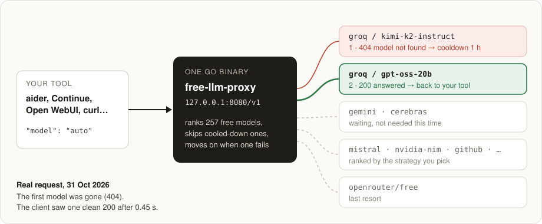
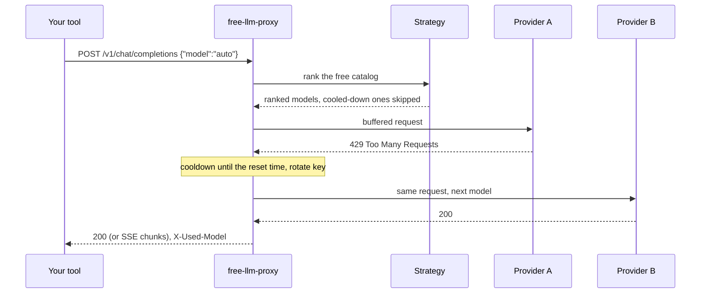

<div align="center">

# free-llm-proxy-router

### Free LLM inference that doesn't run dry.

**One Go binary turns every free LLM tier you have into a single OpenAI-compatible endpoint.**<br>
**When Groq says 429, your request moves on to Gemini, Cerebras or OpenRouter, and your tool never notices.**

[](https://github.com/kaiser-data/free-llm-proxy-router/actions/workflows/ci.yml)
[](https://github.com/kaiser-data/free-llm-proxy-router/releases/latest)
[](go.mod)
[](.github/workflows/ci.yml)
[](LICENSE)

[**Free model list**](FREE_MODELS.md) · [What's new](#whats-new) · [Install](#install) · [PicoClaw & small boards](#run-it-beside-picoclaw-on-a-10-board) · [Strategies](#pick-a-strategy) · [How it works](#how-it-works) · [Limits](#honest-limits)

</div>

> **Try it in one minute.** You need one free key from [Groq](https://console.groq.com/keys) (no credit card). No Go toolchain, no config file. On Linux or macOS:
>
> ```bash
> curl -fsSL https://raw.githubusercontent.com/kaiser-data/free-llm-proxy-router/main/scripts/install.sh | sh
> GROQ_API_KEY=gsk_... ./free-llm-proxy
> ```
>
> In a second terminal:
>
> ```bash
> curl -si localhost:8080/v1/chat/completions -H 'Content-Type: application/json' \
>   -d '{"model":"auto","messages":[{"role":"user","content":"In one sentence: why do free LLM tiers run dry?"}]}'
> ```
>
> The script picks the latest release for your OS and CPU (amd64, arm64, armv6, armv7, riscv64), checks it against `checksums.txt` and unpacks it into the current directory; `VERSION=x.y.z` pins a release, `DIR=…` picks another directory. The `X-Used-Model` header tells you which free model answered. The archive brings its own provider list and free-model catalog. Windows: the `.zip` on the [releases page](https://github.com/kaiser-data/free-llm-proxy-router/releases/latest), or Docker (see [Install](#install)).

<p align="center">
  
</p>

## What's new

On `main` since [v0.1.8](https://github.com/kaiser-data/free-llm-proxy-router/releases/tag/v0.1.8). Credits are in [Contributors](#contributors).

- **Routing is about 24× faster.** Picking a model for a request used to cost about 12 ms and 2.5 MB on one Jetson Orin Nano core with the 3000-model catalog. It now costs **0.5 ms and 160 KB** ([#42](https://github.com/kaiser-data/free-llm-proxy-router/pull/42)). Slower boards such as a Pi Zero spend longer on every request, so they save the most time.
- **Model filters.** You can drop models whose context window is too small or that cannot call tools, before ranking ([#38](https://github.com/kaiser-data/free-llm-proxy-router/pull/38), by [@BenediktChlopik](https://github.com/BenediktChlopik)).
- **More free models, counted correctly.** The list now shows about 480 free-tier models plus about 620 on a free monthly credit, counted apart. It used to claim 3073, inflated by gateways that mix free and paid models. About 440 of the free-tier models come from providers that are on by default.
  - UnoRouter provider ([#36](https://github.com/kaiser-data/free-llm-proxy-router/pull/36)).
  - Free-model detection for gateways that mix free and paid models ([#34](https://github.com/kaiser-data/free-llm-proxy-router/pull/34), [#39](https://github.com/kaiser-data/free-llm-proxy-router/pull/39)).
  - Consent and credit errors from aggregators no longer bench a working key ([#35](https://github.com/kaiser-data/free-llm-proxy-router/pull/35)).
- **A fixed memory ceiling for 512 MB boards.**
  - Provider answers are capped at 16 MB, like requests.
  - The response cache holds at most 16 MB ([#43](https://github.com/kaiser-data/free-llm-proxy-router/pull/43)).
- **Correctness:**
  - Agent profiles that override `stream` or `messages` now change routing, not only the body sent upstream ([#44](https://github.com/kaiser-data/free-llm-proxy-router/pull/44)).
  - `parallel` sends each provider's fastest model ([#45](https://github.com/kaiser-data/free-llm-proxy-router/pull/45)).
  - Config and filters reload together ([#46](https://github.com/kaiser-data/free-llm-proxy-router/pull/46)).
  - Agent tool calls and sampled answers are never served from the cache ([#41](https://github.com/kaiser-data/free-llm-proxy-router/pull/41)).
- **Operations:**
  - `PROXY_AUTH_TOKEN` env override ([#31](https://github.com/kaiser-data/free-llm-proxy-router/pull/31)).
  - Cooldown jitter capped at 5 s ([#32](https://github.com/kaiser-data/free-llm-proxy-router/pull/32)).
  - CI runs every test under the race detector ([#40](https://github.com/kaiser-data/free-llm-proxy-router/pull/40)).

## The idea

Groq, Google AI Studio, Cerebras, OpenRouter, GitHub Models, Mistral and NVIDIA all give away LLM inference on official API keys. Each tier is generous on its own, but small: a few requests per minute, a daily cap, models that disappear without notice. A script or a coding agent that leans on one of them stops working by the afternoon. Wiring all of them together by hand means juggling base URLs, model names, rate-limit headers and cooldowns in every tool.

This proxy does that once, locally, for every tool you use.

| Without | With |
|---|---|
| One provider's 429 stops your agent mid-task | The request moves on to the next free model; your agent sees a normal 200 |
| A model gets retired and your config breaks | A 404 puts that model on cooldown and the next one answers |
| Every tool needs its own key, base URL and model name | Every tool points at `localhost:8080/v1` and asks for `auto` |
| You keep your own list of which models are free this week | [`FREE_MODELS.md`](FREE_MODELS.md) is rebuilt every week by scanning the providers' model APIs |
| Quotas reset at different times, and you track them in your head | Per-model cooldowns, reliability scores and daily usage are tracked and kept across restarts |

## How it works

1. **Your tool** sends a normal OpenAI chat request, with `model` set to `auto`, a strategy (`coding`, `speed`, `long_context`…), an agent profile, or a specific model.
2. **The strategy** ranks the free models in the catalog, for example *"largest context window first"* or *"fastest provider first"*.
3. **The fallback chain** tries them in order. It skips models on cooldown and moves on when a provider fails.

   | Upstream says | The proxy does |
   |---|---|
   | `429` rate limited | cools down that model on that key until the provider's reset time, and retries it at once with your next key if you have several |
   | `400` bad request | skips that provider for this request (also `413`/`422`, and a moderation `403`). If the error blames the model itself (decommissioned, not a chat model), that model sits out for an hour and the provider's next model is tried at once |
   | `404` model not found | cools down that model for an hour |
   | `401`/`403` bad key | cools down that key for ten minutes and tries your next key; the provider sits out only when no key works |
   | `403` from an aggregator about one model (consent needed, upstream out of credit) | cools down only that model and tries the next one; the key stays in use |
   | error inside a `200` stream | handled like the same status sent as a plain response, as long as no content has been sent yet |
   | `5xx` server error | rests that model for 30 seconds and lowers the provider's reliability score |
   | timeout or connection error | moves on and lowers that provider's reliability score |
   | `200` with no content | tries another model; an empty reply cut off by `max_tokens` is kept only as a last resort |
4. **The first good answer** goes back to your tool. With `stream: true` the provider's own SSE stream is passed through token by token: the chain still falls back on anything that fails before the first content chunk (an error status, an error event, an empty stream, a dropped connection), then commits to that provider.
5. **If every free model fails**, or `fallback.request_timeout` (90 s) passes, you get `503` with a `Retry-After` header, never a fake answer. If the request itself was rejected (`400`/`413`/`422`) by every provider that was called, and none was merely skipped for a cooldown (or two different providers rejected it), you get that error instead, since retrying would not help.

## Why not a full AI gateway?

LiteLLM and [OmniRoute](https://github.com/diegosouzapw/OmniRoute) are great when you want hundreds of providers, paid-key budgets and a web dashboard. This project is deliberately smaller:

| | free-llm-proxy-router | Full AI gateways |
|---|---|---|
| Install | one static binary, about 10 MB | Node or Python runtime, Docker, often a database |
| Scope | **free tiers only**: official, recharging, no card | paid, free and subscription logins |
| Terms of service | official API keys only, no OAuth or session reuse | some route through consumer subscriptions |
| Code you have to trust | about 8.8k lines of Go (tests not counted), readable in an afternoon | very large codebases |
| Free-model catalog | discovered from the providers' model APIs, [refreshed weekly](FREE_MODELS.md) | curated lists |
| Runs on | laptop, Raspberry Pi (Zero included), RISC-V boards, NAS, $4 VPS, CI runner | servers |

## Use it with your tools

Anything that speaks the OpenAI API works. Point it at the proxy and use any API key, because the proxy holds the real ones:

```bash
export OPENAI_BASE_URL=http://localhost:8080/v1   # OpenAI SDKs, LangChain, most CLIs
export OPENAI_API_BASE=http://localhost:8080/v1   # older tools, e.g. aider
export OPENAI_API_KEY=unused                      # or your proxy.auth_token
```

In GUI tools (Continue, Cline, Open WebUI, LibreChat…), add an "OpenAI-compatible" provider with base URL `http://localhost:8080/v1`. `GET /v1/models` lists `auto`, every strategy, your agent profiles and all free models, so they show up in model pickers.

## Run it beside PicoClaw on a $10 board

[PicoClaw](https://github.com/sipeed/picoclaw) runs an AI agent on a Pi Zero or a Sipeed RISC-V board. It still needs a model API, and a single free tier runs dry fast. Run this proxy **on the same board** and PicoClaw gets every free tier you have, with fallback, through one local endpoint.

Add it to PicoClaw's `config.json` as a custom OpenAI-compatible provider ([PicoClaw's provider docs](https://github.com/sipeed/picoclaw/blob/main/docs/guides/providers.md)):

```json
{
  "model_list": [
    {
      "model_name": "free",
      "provider": "openai",
      "model": "auto",
      "api_base": "http://localhost:8080/v1",
      "api_keys": ["unused"]
    }
  ],
  "agents": { "defaults": { "model_name": "free" } }
}
```

Use `"model": "coding"`, `"speed"` or any other [strategy](#pick-a-strategy) in place of `auto`.

| | Measured (22 Nov 2026) |
|---|---|
| Binary | about 10 MB, static, no runtime (`CGO_ENABLED=0`, same size on `linux/armv6` and `darwin/arm64`) |
| Memory | about 9 MB resident when idle (macOS arm64, full bundled catalog loaded) |
| Routing overhead | about 0.5 ms and 160 KB per request on one Jetson Orin Nano core, 3000-model catalog (`BenchmarkChatCompletions_Buffered`; was 12 ms and 2.5 MB in v0.1.8) |
| Memory ceiling | requests, provider answers and the response cache are each capped at 16 MB |
| Prebuilt for | `linux/arm` v6 (Pi Zero, Pi 1), v7 (32-bit Pi OS, LicheePi), `linux/riscv64` (LicheeRV Nano), `linux/arm64`, `amd64`, as archives and `.deb`/`.rpm`/`.apk` |

### What failover costs you

How long a client waits for its first token when the first provider fails. Two local upstreams, the first one failing, 400 streaming requests per row, 16 concurrent clients, upstream first token after 25 ms, first-provider timeout 2 s (8-core Apple Silicon Mac, 27 Nov 2026):

| First provider | Completed | p50 TTFT | p95 TTFT | p99 TTFT |
|---|---|---|---|---|
| no proxy (direct to upstream) | 100% | 26.2 ms | 26.6 ms | 26.7 ms |
| healthy | 100% | 26.7 ms | 28.1 ms | 29.9 ms |
| returns 429 | 100% | 27.1 ms | 28.0 ms | 31.1 ms |
| stalls before its first token | 100% | 2028 ms | 2032 ms | 2036 ms |

Each request starts with no health history here, so every one of them pays the fallback. In a running proxy the first failures put the provider on cooldown: after a 429, 11 of 400 requests still reached it; after a stall, 16 did (one per client in flight), and p95 fell back to 33 ms. A 429 costs about half a millisecond. A stall costs the provider's `timeout`, because the proxy cannot tell a slow first token from none. Keep `timeout` short on providers you route latency-sensitive work to. Reproduce with `make bench-failover` (knobs: `FAILOVER_BENCH_N`, `_CONC`, `_TIMEOUT`, `_UPSTREAM_TTFT`).

The [install script](#install) picks the right archive on the board itself. For `mipsle`, `loong64` or other targets, cross-compile from any machine with Go and copy the result over:

```bash
CGO_ENABLED=0 GOOS=linux GOARCH=mipsle go build -ldflags="-s -w" -o free-llm-proxy ./cmd/free-llm-proxy
scp -r free-llm-proxy configs/ user@board.local:$XDG_CONFIG_HOME/free-llm-proxy-router/   # keep configs/ next to the binary
```

On an SD card, `proxy.log_level: "warn"` drops the per-request log lines.

## Pick a strategy

Put a strategy name in the `model` field, or set the default in `config.yaml`:

| Strategy | Picks | Good for |
|---|---|---|
| `auto` / `adaptive` | reliability-weighted ranking that adjusts over time | everyday use |
| `performance` | the largest model available | hard questions |
| `speed` | fastest providers first (Cerebras, Groq) | chat, autocomplete |
| `volume` | highest daily request limits | batch jobs |
| `coding` | models with code capability | coding agents |
| `long_context` | largest context window first (small prompts can rank quality-first, off by default) | long documents |
| `balanced` | 14–79B models | quality per token |
| `small` / `tiny` | 3–13B / under 3B models | low latency |
| `reliable` | highest measured success rate | unattended scripts |
| `economical` | recharging free tiers before credit-based ones | saving credits |
| `similar` | the same model family as a reference model | consistency |
| `parallel` | the fastest model of each of the `fan_out` fastest providers, tried in turn | spreading load across providers |

**Agent profiles** bundle a strategy or a pinned model with defaults, so each tool can ask for its own name. The bundled config defines `coding`, `summariser`, `reliable`, `long-context` and `precise`:

```yaml
proxy:
  agents:
    coding:
      strategy: "coding"
      defaults: { temperature: 0.2, max_tokens: 8192 }   # client values win
    summariser:
      strategy: "volume"
      overrides: { max_tokens: 512 }                      # always applied
```

A pinned model that has left the free catalog falls back to the profile's strategy instead of failing.

**Filters** drop models that cannot serve a request before the strategy ranks the rest ([#13](https://github.com/kaiser-data/free-llm-proxy-router/issues/13)):

```yaml
proxy:
  filters:
    - name: context-fit      # prompt + max_tokens, times margin, must fit the context window
      margin: 1.2
    - name: tool-calling     # requests with tools skip models known not to support them
      unknown: keep          # keep (default) or drop models without that metadata
```

Only OpenRouter reports tool support today, so other providers' models are "unknown". If no model is left, the `openrouter/free` router still runs where unknowns are kept (with `require_parameters` for tool requests); otherwise the client gets a `400 no_model_fits_request`, since a retry would fail the same way. Filters are checked at startup and on reload, so a typo stops the proxy instead of failing requests.

## Providers

One key is enough to start, and every extra key adds capacity. The providers that are on by default serve **about 440 free models** (scan of 22 Nov 2026). [`FREE_MODELS.md`](FREE_MODELS.md), refreshed every Monday, has the current count: about 480 free-tier models in all, plus about 620 that run on a free monthly credit (Vercel AI Gateway, BazaarLink and others); those providers, and a few smaller free ones, ship disabled. **These providers are on by default and stay idle until their key is set:**

| Provider | Free models (scan of 22 Nov 2026) | Key env var | Get a key |
|---|---:|---|---|
| Mistral | 50 | `MISTRAL_API_KEY` | [console.mistral.ai](https://console.mistral.ai) |
| HuggingFace | 50 | `HF_API_KEY` | [huggingface.co/settings/tokens](https://huggingface.co/settings/tokens) |
| GitHub Models | 35 | `GITHUB_TOKEN` | any [GitHub token](https://github.com/settings/tokens) |
| NVIDIA NIM | 23 | `NVIDIA_API_KEY` | [build.nvidia.com](https://build.nvidia.com) |
| Google AI Studio (Gemini) | 21 | `GEMINI_API_KEY` | [aistudio.google.com/app/apikey](https://aistudio.google.com/app/apikey) |
| OpenRouter | 12 | `OPENROUTER_API_KEY` | [openrouter.ai/settings/keys](https://openrouter.ai/settings/keys) |
| Groq | 10 | `GROQ_API_KEY` | [console.groq.com/keys](https://console.groq.com/keys) |
| Cerebras | 2 | `CEREBRAS_API_KEY` | [cloud.cerebras.ai](https://cloud.cerebras.ai) |
| UnoRouter, LLM7, Api.Airforce, ModelScope, Hetzner | see [list](FREE_MODELS.md) | see [`.env.example`](.env.example) | aggregators and smaller free tiers |

`GITHUB_TOKEN` is a common variable: if it is set in your shell, the proxy uses it for GitHub Models.

About 25 more providers ship **disabled** in [`configs/config.example.yaml`](configs/config.example.yaml): gateways that also sell paid models, credit-based tiers, keyless endpoints and local servers (Ollama, LM Studio, llama.cpp…). Each has a comment saying why. Review one, then set `enabled: true`. For a gateway that mixes free and paid models, set `discovery.free_markers` (an ID suffix such as `:free`) or `discovery.free_detect_field` / `free_detect_value` (a field such as `isFree`), so that only its free models are cataloged.

Several keys per provider are pooled automatically: add `GROQ_API_KEY_2`, `GROQ_API_KEY_3`… and on a 429 the proxy retries the same model with the next key. Free tiers change often, so check each provider's own terms.

## Install

| | Command |
|---|---|
| **Install script** (Linux, macOS) | `curl -fsSL https://raw.githubusercontent.com/kaiser-data/free-llm-proxy-router/main/scripts/install.sh \| sh` ([read it first](scripts/install.sh)) |
| **Docker** (amd64, arm64) | `docker run --rm -p 127.0.0.1:8080:8080 -e GROQ_API_KEY=gsk_... ghcr.io/kaiser-data/free-llm-proxy-router:latest` |
| **Debian, Fedora, Alpine** | `.deb`, `.rpm` and `.apk` on the [releases page](https://github.com/kaiser-data/free-llm-proxy-router/releases/latest) |
| **Archive** (Linux, macOS, Windows) | `.tar.gz` / `.zip` on the [releases page](https://github.com/kaiser-data/free-llm-proxy-router/releases/latest); keep `configs/` next to the binaries |
| **From source** | `git clone … && make build` (binaries land in `bin/`) |
| **Go** | `go install github.com/kaiser-data/free-llm-proxy-router/cmd/free-llm-proxy@latest` (binary only, so pass `-c config.yaml`) |

Every package ships three binaries plus `configs/` (the provider definitions and the free-model catalog):

| Binary | Does |
|---|---|
| `free-llm-proxy` | the OpenAI-compatible proxy |
| `free-llm-scan` | discovers free models, probes them, exports `FREE_MODELS.md` |
| `free-llm-bench` | benchmarks every strategy across your providers |

<details>
<summary><b>Package install, step by step</b></summary>

```bash
VERSION=0.1.8
# Debian/Ubuntu
curl -LO https://github.com/kaiser-data/free-llm-proxy-router/releases/download/v$VERSION/free-llm-proxy-router_${VERSION}_amd64.deb
sudo dpkg -i free-llm-proxy-router_${VERSION}_amd64.deb      # or: sudo rpm -i …rpm / sudo apk add --allow-untrusted …apk

# macOS on Apple Silicon, from the archive
curl -LO https://github.com/kaiser-data/free-llm-proxy-router/releases/download/v$VERSION/free-llm-proxy-router_${VERSION}_darwin_arm64.tar.gz
tar xzf free-llm-proxy-router_${VERSION}_darwin_arm64.tar.gz && ./free-llm-proxy --help
```

</details>

### Keys and config

Keys are read from, first match wins:

1. environment variables (`export GROQ_API_KEY=...`)
2. `.env` in the working directory (see [`.env.example`](.env.example) for every supported key)
3. `$XDG_CONFIG_HOME/free-llm-proxy-router/.env` or `.secrets`, which work from any directory

Config is read from `-c path`, `./config.yaml` or `$XDG_CONFIG_HOME/free-llm-proxy-router/config.yaml`, and falls back to the bundled [`configs/config.example.yaml`](configs/config.example.yaml). Start it with `-c path/to/config.yaml` and most edits apply without a restart (`auth_token` and `host` need one). `bash scripts/setup.sh` writes a starter config to `$XDG_CONFIG_HOME/free-llm-proxy-router/`.

```yaml
proxy:
  strategy: "adaptive"   # default when a request says "auto"
  host: "127.0.0.1"      # "0.0.0.0" to expose it, and then set auth_token too
  port: 8080
  auth_token: ""         # when set, clients must send it as their API key
```

**It spends your quotas, so it listens on `127.0.0.1` by default.** To reach it from other machines, use `--host 0.0.0.0` *and* set a token. Without one it refuses to start on a non-loopback host; pass `--allow-no-auth` (or set `proxy.allow_no_auth: true`) only if access is already restricted, e.g. by a firewall or VPN. `PROXY_AUTH_TOKEN` in the environment or `.env` overrides `proxy.auth_token`, so the token never has to sit in a config file you might commit (`docker run -e PROXY_AUTH_TOKEN=…` works the same way). The Docker image listens on all interfaces inside the container, so publish its port to `127.0.0.1` as shown above.

### Keep the catalog fresh

```bash
./bin/free-llm-scan update        # rescan your providers, write the catalog
./bin/free-llm-scan export-md     # render it as a Markdown list
```

Or let one machine scan on a schedule and every other machine pull the result: see `catalog.git_sync` in the config. Before enabling a gateway that also sells paid models, check that its config entry sets `free_markers` or `free_detect_field` (see [Providers](#providers)); without one, the scan catalogs every model it lists.

## API

| Endpoint | Does |
|---|---|
| `POST /v1/chat/completions` | chat, streaming or not, routed through the fallback chain |
| `GET /v1/models` | `auto`, strategies, agent profiles and every free model |
| `GET /health` | liveness check |

| Response header | Means |
|---|---|
| `X-Used-Model` | the model that actually answered |
| `X-Cache: HIT` | served from the short response cache (at most 16 MB): non-streaming requests without tools, with `temperature` 0 or unset and `n` ≤ 1 |
| `X-Proxy-Exhausted` + `Retry-After` | every free model failed (`503`); retry after that many seconds |

<details>
<summary><b>Architecture</b></summary>



```
cmd/
  free-llm-proxy/   the proxy server
  free-llm-scan/    free-model discovery, probing, FREE_MODELS.md export
  free-llm-bench/   strategy benchmark
pkg/
  proxy/            HTTP handlers, fallback chain, SSE re-emission, cache
  strategy/         the routing strategies
  catalog/          catalog model, persistence, hot reload, git sync
  scan/             one scanner per provider API
  ratelimit/        rate-limit header parsing, cooldowns, daily usage
  reliability/      per-provider success rates
  config/           config loading, key discovery, hot reload
configs/            bundled config and the free-model catalog
```

</details>

## Honest limits

- **Free tiers are small, and they change.** The proxy makes the most of them. It does not create capacity, and it is not a fit for production traffic with an SLA.
- **A stream that breaks after its first token cannot fall back.** The client already has part of the answer, so the stream ends with an SSE error event (`stream_interrupted`), never with a clean end that would look like a complete answer. That includes a provider that closes its connection cleanly before sending `[DONE]` or a `finish_reason`. Gemini is still buffered (its thought blocks are stripped from the full answer) and re-emitted as SSE.
- **The catalog can lag a provider's change by up to a week.** Models that vanish are cooled down on the first 404 and skipped.
- **A provider that stalls before its first token costs its full `timeout`** before the fallback starts (15–30 s in the example config). After that the provider is cooled down and skipped. See [What failover costs you](#what-failover-costs-you).
- **Local quota tracking is best-effort.** The proxy honours the providers' rate-limit headers, but under heavy concurrency a provider may still send the occasional 429, which simply triggers the fallback.

## Development

```bash
go test -race ./...    # 154 tests
go vet ./...
make build
```

**Next:** Gemini tool-call signatures across turns ([#30](https://github.com/kaiser-data/free-llm-proxy-router/pull/30)) · OpenRouter `models[]` capped at 3 ([#33](https://github.com/kaiser-data/free-llm-proxy-router/pull/33)) · ranking only the top candidates instead of the whole catalog.

## Contributors

Thank you to everyone who has helped make this better. Every report, review and pull request has shaped how the proxy behaves today.

- [@zedtux](https://github.com/zedtux):
  - free-model detection for gateways that mix free and paid models ([#34](https://github.com/kaiser-data/free-llm-proxy-router/pull/34));
  - the UnoRouter provider ([#36](https://github.com/kaiser-data/free-llm-proxy-router/pull/36)) and its consent and credit errors ([#35](https://github.com/kaiser-data/free-llm-proxy-router/pull/35));
  - `PROXY_AUTH_TOKEN` ([#31](https://github.com/kaiser-data/free-llm-proxy-router/pull/31)) and shorter cooldowns after a daily reset ([#32](https://github.com/kaiser-data/free-llm-proxy-router/pull/32));
  - a private request body for every provider attempt ([#25](https://github.com/kaiser-data/free-llm-proxy-router/pull/25)) and `max_completion_tokens` handling ([#18](https://github.com/kaiser-data/free-llm-proxy-router/pull/18)).
  - In progress: Gemini thought signatures for multi-turn tool calls ([#30](https://github.com/kaiser-data/free-llm-proxy-router/pull/30)) and a tighter OpenRouter fallback ([#33](https://github.com/kaiser-data/free-llm-proxy-router/pull/33)).
- [@BenediktChlopik](https://github.com/BenediktChlopik):
  - **model filters** for context fit and tool calling ([#26](https://github.com/kaiser-data/free-llm-proxy-router/pull/26), merged in [#38](https://github.com/kaiser-data/free-llm-proxy-router/pull/38)), which started with their request for intelligent model routing ([#13](https://github.com/kaiser-data/free-llm-proxy-router/issues/13));
  - empty-completion detection, so a `200` with no content is never passed off as an answer ([#14](https://github.com/kaiser-data/free-llm-proxy-router/issues/14), [#16](https://github.com/kaiser-data/free-llm-proxy-router/pull/16), [#17](https://github.com/kaiser-data/free-llm-proxy-router/pull/17));
  - new free providers ([#12](https://github.com/kaiser-data/free-llm-proxy-router/pull/12), [#15](https://github.com/kaiser-data/free-llm-proxy-router/pull/15));
  - answering other users in the issue tracker ([#1](https://github.com/kaiser-data/free-llm-proxy-router/issues/1)).
- [@oomplay](https://github.com/oomplay): the first UnoRouter integration and the idea of canonical model aliases ([#2](https://github.com/kaiser-data/free-llm-proxy-router/pull/2)).
- [@Ludwik900](https://github.com/Ludwik900): the first bug report, a scan that found no models ([#1](https://github.com/kaiser-data/free-llm-proxy-router/issues/1)). It showed that a scan without a config still reported success with 0 entries.

## Acknowledgments

Free-tier limits and change tracking are informed by [cheahjs/free-llm-api-resources](https://github.com/cheahjs/free-llm-api-resources), the community reference for free LLM APIs.

---

<div align="center">

Built by [kaiser-data](https://github.com/kaiser-data) · MIT licensed · Issues and PRs welcome<br>
Keys stay in your environment or `.env`; never commit them.

</div>
