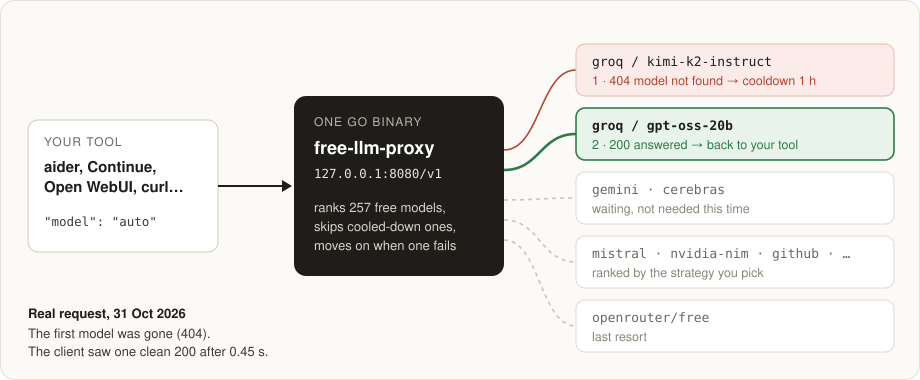
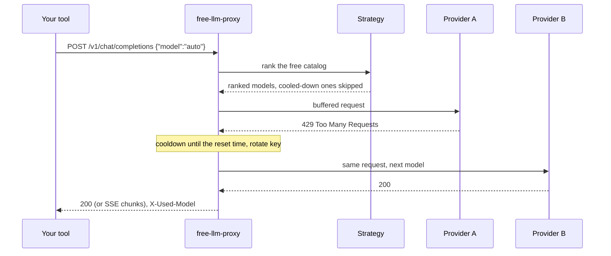

<div align="center">

# free-llm-proxy-router

### Free LLM inference that doesn't run dry.

**One Go binary turns every free LLM tier you have into a single OpenAI-compatible endpoint.**<br>
**When Groq says 429, your request moves on to Gemini, Cerebras or OpenRouter, and your tool never notices.**

[](https://github.com/kaiser-data/free-llm-proxy-router/actions/workflows/ci.yml)
[](https://github.com/kaiser-data/free-llm-proxy-router/releases/latest)
[](go.mod)
[](.github/workflows/ci.yml)
[](LICENSE)

[**Free model list**](FREE_MODELS.md) · [Install](#install) · [Strategies](#pick-a-strategy) · [How it works](#how-it-works) · [Limits](#honest-limits)

</div>

> **Try it in one minute.** You need Go 1.23+ and one free key from [Groq](https://console.groq.com/keys) (no credit card).
>
> ```bash
> git clone https://github.com/kaiser-data/free-llm-proxy-router && cd free-llm-proxy-router
> make build && GROQ_API_KEY=gsk_... ./bin/free-llm-proxy
> ```
>
> In a second terminal:
>
> ```bash
> curl -si localhost:8080/v1/chat/completions -H 'Content-Type: application/json' \
>   -d '{"model":"auto","messages":[{"role":"user","content":"In one sentence: why do free LLM tiers run dry?"}]}'
> ```
>
> The `X-Used-Model` header tells you which free model answered. No config file is needed: the binary uses the bundled provider list and its catalog of free models.

<p align="center">
  
</p>

## The idea

Groq, Google AI Studio, Cerebras, OpenRouter, GitHub Models, Mistral and NVIDIA all give away LLM inference on official API keys. Each tier is generous on its own, but small: a few requests per minute, a daily cap, models that disappear without notice. A script or a coding agent that leans on one of them stops working by the afternoon. Wiring all of them together by hand means juggling base URLs, model names, rate-limit headers and cooldowns in every tool.

This proxy does that once, locally, for every tool you use.

| Without | With |
|---|---|
| One provider's 429 stops your agent mid-task | The request moves on to the next free model; your agent sees a normal 200 |
| A model gets retired and your config breaks | A 404 puts that model on cooldown and the next one answers |
| Every tool needs its own key, base URL and model name | Every tool points at `localhost:8080/v1` and asks for `auto` |
| You keep your own list of which models are free this week | [`FREE_MODELS.md`](FREE_MODELS.md) is rebuilt every week by scanning the providers' model APIs |
| Quotas reset at different times, and you track them in your head | Per-model cooldowns, reliability scores and daily usage are tracked and kept across restarts |

## How it works

1. **Your tool** sends a normal OpenAI chat request, with `model` set to `auto`, a strategy (`coding`, `speed`, `long_context`…), an agent profile, or a specific model.
2. **The strategy** ranks the free models in the catalog, for example *"largest context window first"* or *"fastest provider first"*.
3. **The fallback chain** tries them in order. It skips models on cooldown and moves on when a provider fails.

   | Upstream says | The proxy does |
   |---|---|
   | `429` rate limited | cools down that model until the provider's reset time, rotates to your next key if you have several |
   | `404` model not found | cools down that model for an hour |
   | `401`/`403` bad key | cools down the provider for ten minutes |
   | timeout or connection error | moves on and lowers that provider's reliability score |
   | empty reply cut off by `max_tokens` | tries another model and keeps the empty one only as a last resort |
4. **The first good answer** goes back to your tool. If you asked for `stream: true`, it arrives as standard SSE chunks.
5. **If every free model fails**, you get `503` with a `Retry-After` header, never a fake answer.

## Why not a full AI gateway?

LiteLLM and [OmniRoute](https://github.com/diegosouzapw/OmniRoute) are great when you want hundreds of providers, paid-key budgets and a web dashboard. This project is deliberately smaller:

| | free-llm-proxy-router | Full AI gateways |
|---|---|---|
| Install | one static binary, about 11 MB | Node or Python runtime, Docker, often a database |
| Scope | **free tiers only**: official, recharging, no card | paid, free and subscription logins |
| Terms of service | official API keys only, no OAuth or session reuse | some route through consumer subscriptions |
| Code you have to trust | about 7.4k lines of Go, readable in an afternoon | very large codebases |
| Free-model catalog | discovered from the providers' model APIs, [refreshed weekly](FREE_MODELS.md) | curated lists |
| Runs on | laptop, Raspberry Pi, NAS, $4 VPS, CI runner | servers |

## Use it with your tools

Anything that speaks the OpenAI API works. Point it at the proxy and use any API key, because the proxy holds the real ones:

```bash
export OPENAI_BASE_URL=http://localhost:8080/v1   # OpenAI SDKs, LangChain, most CLIs
export OPENAI_API_BASE=http://localhost:8080/v1   # older tools, e.g. aider
export OPENAI_API_KEY=unused                      # or your proxy.auth_token
```

In GUI tools (Continue, Cline, Open WebUI, LibreChat…), add an "OpenAI-compatible" provider with base URL `http://localhost:8080/v1`. `GET /v1/models` lists `auto`, every strategy, your agent profiles and all free models, so they show up in model pickers.

## Pick a strategy

Put a strategy name in the `model` field, or set the default in `config.yaml`:

| Strategy | Picks | Good for |
|---|---|---|
| `auto` / `adaptive` | reliability-weighted ranking that adjusts over time | everyday use |
| `performance` | the largest model available | hard questions |
| `speed` | fastest providers first (Cerebras, Groq) | chat, autocomplete |
| `volume` | highest daily request limits | batch jobs |
| `coding` | models with code capability | coding agents |
| `long_context` | largest context window first | long documents |
| `balanced` | 14–79B models | quality per token |
| `small` / `tiny` | 3–13B / under 3B models | low latency |
| `reliable` | highest measured success rate | unattended scripts |
| `economical` | recharging free tiers before credit-based ones | saving credits |
| `similar` | the same model family as a reference model | consistency |
| `parallel` | several models for fan-out | comparisons |

**Agent profiles** bundle a strategy or a pinned model with defaults, so each tool can ask for its own name. The bundled config defines `coding`, `summariser`, `reliable`, `long-context` and `precise`:

```yaml
proxy:
  agents:
    coding:
      strategy: "coding"
      defaults: { temperature: 0.2, max_tokens: 8192 }   # client values win
    summariser:
      strategy: "volume"
      overrides: { max_tokens: 512 }                      # always applied
```

A pinned model that has left the free catalog falls back to the profile's strategy instead of failing.

## Providers

**257 free models across 8 providers**, from the weekly scan of 26 Oct 2026 ([full list](FREE_MODELS.md)). One key is enough to start, and every extra key adds capacity.

| Provider | Free models | Get a key |
|---|---:|---|
| NVIDIA NIM | 71 | [build.nvidia.com](https://build.nvidia.com) |
| HuggingFace | 50 | [huggingface.co/settings/tokens](https://huggingface.co/settings/tokens) |
| Mistral | 50 | [console.mistral.ai](https://console.mistral.ai) |
| GitHub Models | 35 | any [GitHub token](https://github.com/settings/tokens) |
| Google AI Studio (Gemini) | 21 | [aistudio.google.com/app/apikey](https://aistudio.google.com/app/apikey) |
| OpenRouter | 18 | [openrouter.ai/settings/keys](https://openrouter.ai/settings/keys) |
| Groq | 10 | [console.groq.com/keys](https://console.groq.com/keys) |
| Cerebras | 2 | [cloud.cerebras.ai](https://cloud.cerebras.ai) |
| Ollama (local) | your models | no key |

Several keys per provider are pooled automatically: add `GROQ_API_KEY_2`, `GROQ_API_KEY_3`… and the proxy rotates on 429. Free tiers change often, so check each provider's own terms.

## Install

| | Command |
|---|---|
| **Homebrew** (macOS, Linux) | `brew install kaiser-data/tap/free-llm-proxy-router` |
| **Docker** (amd64, arm64) | `docker run --rm -p 127.0.0.1:8080:8080 -e GROQ_API_KEY=gsk_... ghcr.io/kaiser-data/free-llm-proxy-router:latest` |
| **Debian, Fedora, Alpine** | `.deb`, `.rpm` and `.apk` on the [releases page](https://github.com/kaiser-data/free-llm-proxy-router/releases/latest) |
| **Archive** (Linux, macOS, Windows) | `.tar.gz` / `.zip` on the [releases page](https://github.com/kaiser-data/free-llm-proxy-router/releases/latest); keep `configs/` next to the binaries |
| **From source** | `git clone … && make build` (binaries land in `bin/`) |
| **Go** | `go install github.com/kaiser-data/free-llm-proxy-router/cmd/free-llm-proxy@latest` (binary only, so pass `-c config.yaml`) |

Every package ships three binaries plus `configs/` (the provider definitions and the free-model catalog):

| Binary | Does |
|---|---|
| `free-llm-proxy` | the OpenAI-compatible proxy |
| `free-llm-scan` | discovers free models, probes them, exports `FREE_MODELS.md` |
| `free-llm-bench` | benchmarks every strategy across your providers |

<details>
<summary><b>Package install, step by step</b></summary>

```bash
VERSION=0.1.3
# Debian/Ubuntu
curl -LO https://github.com/kaiser-data/free-llm-proxy-router/releases/download/v$VERSION/free-llm-proxy-router_${VERSION}_amd64.deb
sudo dpkg -i free-llm-proxy-router_${VERSION}_amd64.deb      # or: sudo rpm -i …rpm / sudo apk add --allow-untrusted …apk

# macOS on Apple Silicon, from the archive
curl -LO https://github.com/kaiser-data/free-llm-proxy-router/releases/download/v$VERSION/free-llm-proxy-router_${VERSION}_darwin_arm64.tar.gz
tar xzf free-llm-proxy-router_${VERSION}_darwin_arm64.tar.gz && ./free-llm-proxy --help
```

</details>

### Keys and config

Keys are read from, first match wins:

1. environment variables (`export GROQ_API_KEY=...`)
2. `.env` in the working directory (see [`.env.example`](.env.example) for every supported key)
3. `~/.free-llm-proxy-router/.env` or `.secrets`, which work from any directory

Config is read from `-c path`, `./config.yaml` or `~/.free-llm-proxy-router/config.yaml`, and falls back to the bundled [`configs/config.example.yaml`](configs/config.example.yaml). Start it with `-c path/to/config.yaml` and most edits apply without a restart (`auth_token` and `host` need one). `bash scripts/setup.sh` writes a starter config to `~/.free-llm-proxy-router/`.

```yaml
proxy:
  strategy: "adaptive"   # default when a request says "auto"
  host: "127.0.0.1"      # "0.0.0.0" to expose it, and then set auth_token too
  port: 8080
  auth_token: ""         # when set, clients must send it as their API key
```

**It spends your quotas, so it listens on `127.0.0.1` by default.** To reach it from other machines, use `--host 0.0.0.0` *and* set `proxy.auth_token`. The proxy logs a warning if you expose it without a token. The Docker image listens on all interfaces inside the container, so publish its port to `127.0.0.1` as shown above.

### Keep the catalog fresh

```bash
./bin/free-llm-scan update        # rescan your providers, write the catalog
./bin/free-llm-scan export-md     # render it as a Markdown list
```

Or let one machine scan on a schedule and every other machine pull the result: see `catalog.git_sync` in the config.

## API

| Endpoint | Does |
|---|---|
| `POST /v1/chat/completions` | chat, streaming or not, routed through the fallback chain |
| `GET /v1/models` | `auto`, strategies, agent profiles and every free model |
| `GET /health` | liveness check |

| Response header | Means |
|---|---|
| `X-Used-Model` | the model that actually answered |
| `X-Cache: HIT` | served from the short response cache (non-streaming only) |
| `X-Proxy-Exhausted` + `Retry-After` | every free model failed (`503`); retry after that many seconds |

<details>
<summary><b>Architecture</b></summary>



```
cmd/
  free-llm-proxy/   the proxy server
  free-llm-scan/    free-model discovery, probing, FREE_MODELS.md export
  free-llm-bench/   strategy benchmark
pkg/
  proxy/            HTTP handlers, fallback chain, SSE re-emission, cache
  strategy/         the routing strategies
  catalog/          catalog model, persistence, hot reload, git sync
  scan/             one scanner per provider API
  ratelimit/        rate-limit header parsing, cooldowns, daily usage
  reliability/      per-provider success rates
  config/           config loading, key discovery, hot reload
configs/            bundled config and the free-model catalog
```

</details>

## Honest limits

- **Free tiers are small, and they change.** The proxy makes the most of them. It does not create capacity, and it is not a fit for production traffic with an SLA.
- **Streaming is buffered.** Providers are called without streaming so that a failure can fall back mid-request; the answer is re-emitted as SSE once it is complete. Time to first token equals the full response time.
- **The catalog can lag a provider's change by up to a week.** Models that vanish are cooled down on the first 404 and skipped.
- **Local quota tracking is best-effort.** The proxy honours the providers' rate-limit headers, but under heavy concurrency a provider may still send the occasional 429, which simply triggers the fallback.

## Development

```bash
go test -race ./...    # 78 tests
go vet ./...
make build
```

**Next:** a single admission path for every upstream call (atomic quota reservations, per-key cooldowns, a request deadline) · real SSE pass-through · fixing the GitHub Models scanner.

## Acknowledgments

Free-tier limits and change tracking are informed by [cheahjs/free-llm-api-resources](https://github.com/cheahjs/free-llm-api-resources), the community reference for free LLM APIs.

---

<div align="center">

Built by [kaiser-data](https://github.com/kaiser-data) · MIT licensed · Issues and PRs welcome<br>
Keys stay in your environment or `.env`; never commit them.

</div>
